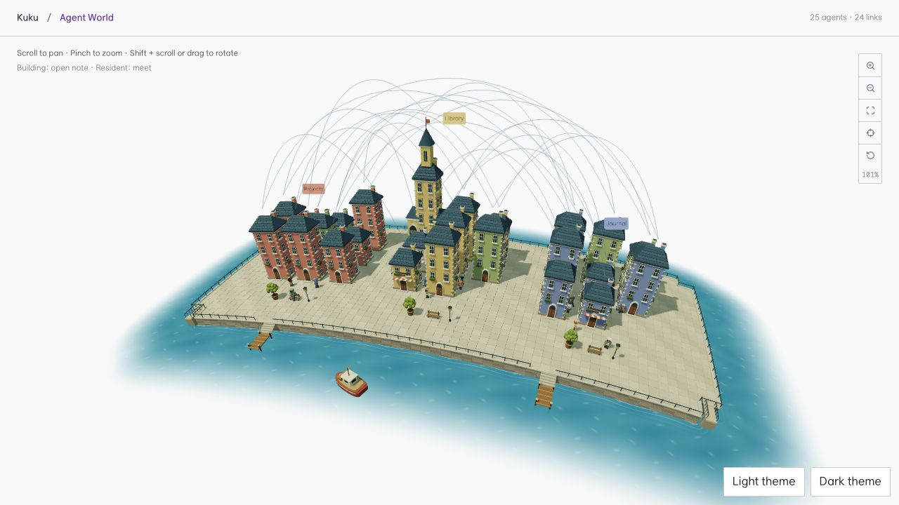
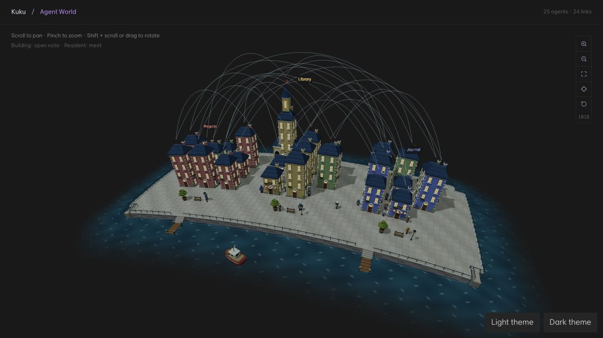
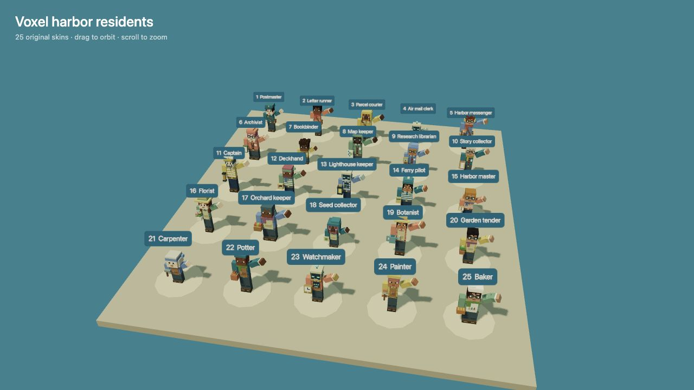

# Agent World: harbor, residents and aerial graph

Agent World renders note nodes as a procedural Three.js harbor, with 25 original voxel resident variants and graph relationships above the rooftops. All geometry is generated locally; no new asset service or package dependency is required.

## Scene and interaction

- Limestone quays, pastel houses, a library tower, slate roofs, docks, trees and a mail boat replace the old island presentation.
- A shared curved-surface projection places the town, water, characters, picking targets, labels and camera targets on a gently curved local patch. Rigid buildings retain a common tangent frame. The camera does not need to show a whole planet.
- Light and dark service themes change water, lighting, labels and windows. The transparent canvas blends into the application background.
- Building selection opens its note. Resident selection exposes greeting, follow, note opening and delivery actions. Escape clears selection/follow.
- Scroll pans, pinch zooms and Shift-scroll or drag rotates. Controls and header reuse the graph surface styling.
- Graph edges are roof-to-roof quadratic curves: up to 600 faint overview edges and 32 highlighted selected relationships with moving packets. Density reduces overview opacity. Repeated focus reuses geometry.
- Deliveries visualize existing adjacency and walk around obstacles on the quay. They never edit note links or send external messages. Compatible rebuilds restore resident missions; invalid routes/layouts reset safely.

## Residents and animation

There are 25 original variants, including three helper robots, with varied builds, stature, hairstyles, hats, colors and profession props. Instances share model resources but have independent rigs. Walking, resting, greeting, entering a home and delivery/return use the same resident lifecycle.

Greeting converts the actual camera position into the resident's tangent frame and turns toward it. The right arm lifts outward; head/hat bounds and arm reach determine a safe lift angle. The raise and lower blend smoothly. Tests sample all 25 variants across 180 frames and require no forearm intersection with head/hat bounds.

Matte diffuse materials, separated crown planes, thicker hat layers and omission of covered bulky hair reduce shimmering and coplanar depth competition. Crown ray-depth checks cover every variant.

## Rendering and loading

The renderer uses one MSAA pass instead of the previous SSAO/compositor chain. It retains 2048-pixel sunlight shadows refreshed at 10 Hz, caps DPR at 1.25 and backing pixels at 1.8 million, and targets 30 FPS. Hidden/offscreen canvases skip rendering. These are resource limits, not an FPS guarantee.

Tiny pavers/slates use simpler geometry. The ocean is a tessellated local patch. Character templates and the walking grid initialize lazily; navigation caches at most eight BFS origin trees. World rebuilds coalesce for 60 ms, identical inputs skip rebuilding, and background indexing keeps the current scene visible.

### Measurement

The same 25-note headless scene used 1,544,414 visible triangles before optimization and 326,802 afterward: **78.8% fewer triangles**. Visible mesh count stayed approximately constant (247 to 246). Single construction samples were 276 ms before and 62 ms afterward; the isolated PR branch repeated at 66 ms. These samples exclude GPU shader compilation and native startup and are not a statistical latency/FPS comparison.

A prior browser run of the 320-note fixture completed construction in 198 ms with roughly 2.30 million rendered triangles and the 120-resident limit. Large worlds can still be GPU-bound. DOM diagnostics expose scene construction time, draw calls and triangle counts.

## Verification

On the isolated branch based on `main`:

- 9 test files / 47 tests passed, including the opt-in scene benchmark.
- The full graph-view test suite also passed: 11 files / 40 tests (the shared controls tests overlap with the count above).
- Full desktop TypeScript project build passed.
- Vite production build passed; the existing large-chunk advisory remains.

The implementation was also exercised in the browser for light/dark, loading completion, selection/open callback, greeting, delivery across a theme change, a 360-pixel panel, 320 nodes and the 25-resident waving gallery. Those visual runs preceded branch extraction; the isolated branch reran tests and the production build. Included screenshots use synthetic notes only.

From the repository root, after installing dependencies:

```sh
AGENT_WORLD_BENCH=1 node apps/desktop/node_modules/vitest/vitest.mjs run --root apps/desktop src/plugins/builtin/voxel_graph src/plugins/builtin/graph_view/graph_trackpad_controls.test.ts --no-file-parallelism --testTimeout=60000
cd apps/desktop
node node_modules/typescript/bin/tsc -b
node node_modules/vite/bin/vite.js build
node node_modules/vite/bin/vite.js --port 5174
```

Development-only fixture routes:

- `/tests/agent-world/?nodes=25&theme=light&tools`
- `/tests/agent-world/?nodes=25&theme=dark&tools`
- `/tests/agent-world/?nodes=320`
- `/tests/agent-world/?nodes=25&compact`
- `/tests/agent-world/residents.html`

## Review images






## Shared graph integration

The shared graph stylesheet, trackpad helper and its tests are byte-identical to the versions in PR #54 at extraction. This branch includes those small dependencies so it builds independently against `main`; it does not include the graph renderer redesign from that PR. Both PRs add the same localized trackpad hint and stylesheet import; retain one copy when integrating them.
